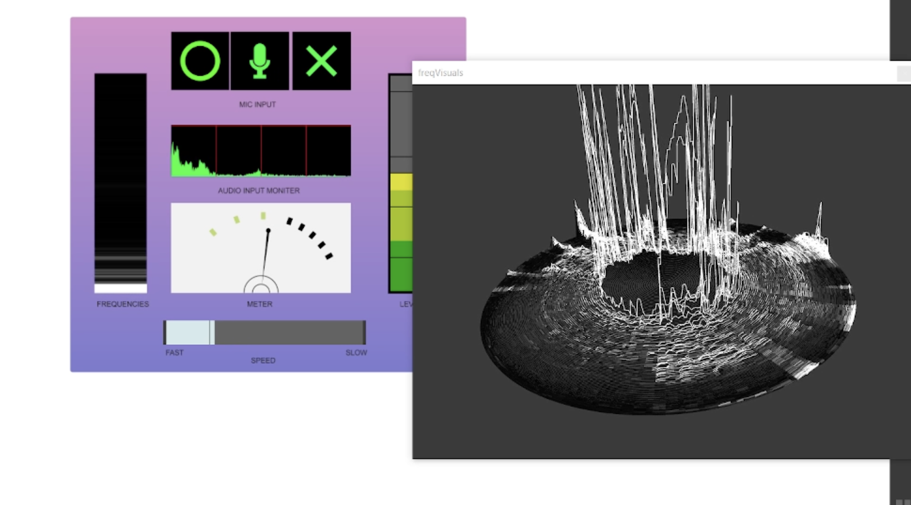
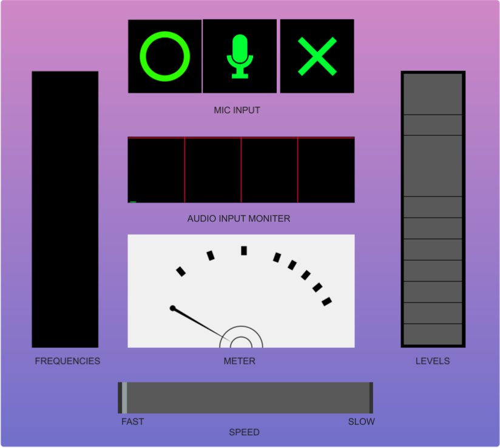
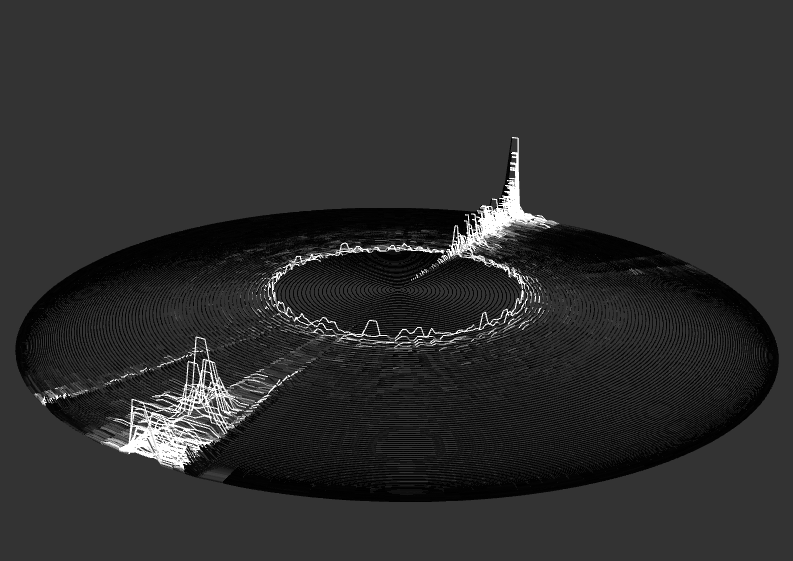
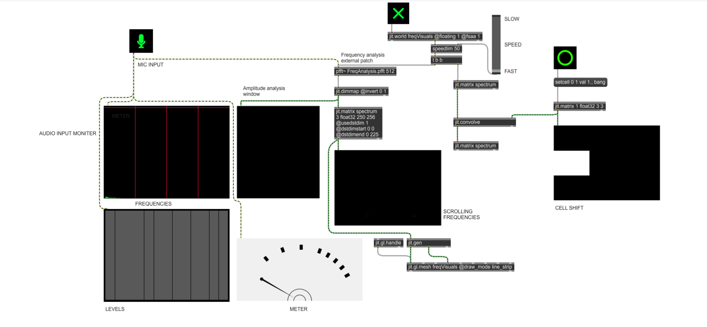
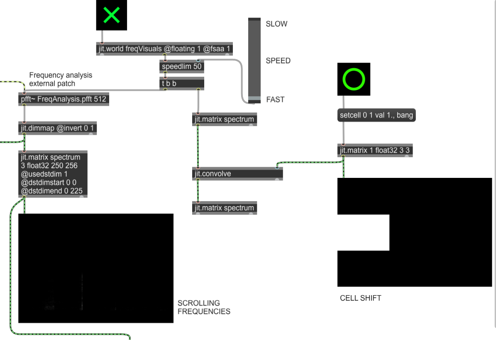

# Vinyl Audio Visualizer (Max/MSP + Jitter)

A real-time audio visualizer built in Max/MSP and Jitter. It listens to the microphone, analyses the incoming sound with an FFT, and draws the frequency content as a rotating 3D "vinyl record". Waveforms rise from the surface of the vinyl as sound is heard: **low frequencies sit towards the centre and high frequencies towards the outer edge**, peaking in 3D space in real time.



## Inspiration

Inspired by the video for *The Oracle*, a theme song by A.R. Rahman, one of my favourite musicians.
Reference: [The Oracle – A.R. Rahman](https://youtu.be/A9DI13NF7fY)

## Screenshots

| Presentation mode | 3D vinyl render |
|---|---|
|  |  |

**Full patch**



**Jitter section (frequency analysis, spectrum history and cell shift)**



## How it works

1. **Audio input** – `ezadc~` takes the microphone signal. A `spectroscope~` (audio input monitor), a level meter and a needle meter show the raw input.
2. **Frequency analysis** – `pfft~ FreqAnalysis.pfft 512` runs an FFT. Inside the subpatch, `cartopol~` converts each bin to amplitude, and `jit.poke~` writes the amplitudes into a shared Jitter matrix called `analysis`.
3. **Spectrum history** – `jit.dimmap` and `jit.matrix spectrum` (250 × 256) build a scrolling history of the spectrum ("scrolling frequencies").
4. **Cell shift** – `jit.convolve` with a 3 × 3 kernel shifts the spectrum matrix by one cell each frame, so older frames move outward and the record appears to rotate.
5. **Speed control** – `speedlim` on the `jit.world` frame bang, driven by the SPEED slider, sets how fast the vinyl updates.
6. **3D geometry** – a `jit.gen` patch maps the spectrum onto a sphere-based surface, turning amplitude into height (z), which gives the vinyl its peaks.
7. **Rendering** – `jit.gl.mesh` (draw mode `line_strip`) draws the geometry inside `jit.world`. `jit.gl.handle` lets you rotate and zoom the vinyl with the mouse.

## Controls (presentation mode)

| Control | What it does |
|---|---|
| ◯ (circle) | Sets the cell-shift kernel |
| 🎤 (mic) | Turns audio / microphone input on |
| ✕ (cross) | Starts the `jit.world` render window |
| SPEED slider | Fast ↔ slow update rate of the vinyl |
| Frequencies / Levels / Meter | Live monitors of the input signal |

> **Note:** The patch in this repository is an earlier save. The screenshots show the final version, which adds the SPEED slider (`speedlim`), labels, the needle meter and the presentation-mode layout. The core visualizer (FFT analysis, spectrum history, cell shift and 3D vinyl rendering) is the same.

## Requirements

- Max 8.1 or later (built with Max 8.1.11)
- A microphone or audio input device

## How to run

1. Download or clone this repository.
2. Open `Atharva Bankar Visual Patch.maxproj` in Max (this opens the main patch).
3. Click the **◯** button to set up the cell-shift kernel.
4. Click the **mic** button to turn on audio input.
5. Click the **✕** toggle to open the render window.
6. Make some sound and watch the vinyl react. Use the SPEED slider to change how fast it moves, and drag in the render window to rotate it.

## Project structure

```
vinyl-audio-visualizer/
├── Atharva Bankar Visual Patch.maxproj   # Max project file – open this
├── patchers/
│   ├── Atharva_Bankar_Assesment_01.maxpat   # Main visualizer patch
│   └── FreqAnalysis.pfft.maxpat             # FFT subpatch used by pfft~ (required)
├── screenshots/                             # Patch and presentation-mode images
└── README.md
```

## Acknowledgements

- Lectures by Francesc at university, which introduced me to Max/MSP and Jitter.
- Online tutorials (YouTube) on Jitter, FFT analysis and OpenGL rendering in Max.

## Author

Atharva Bankar
